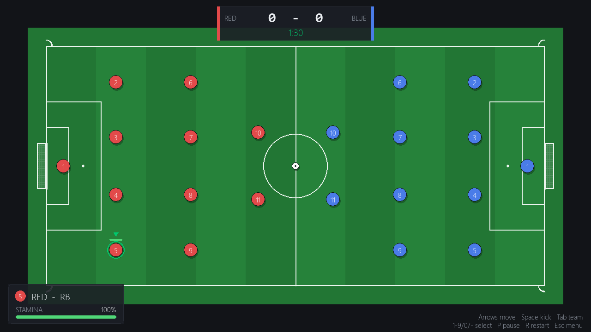
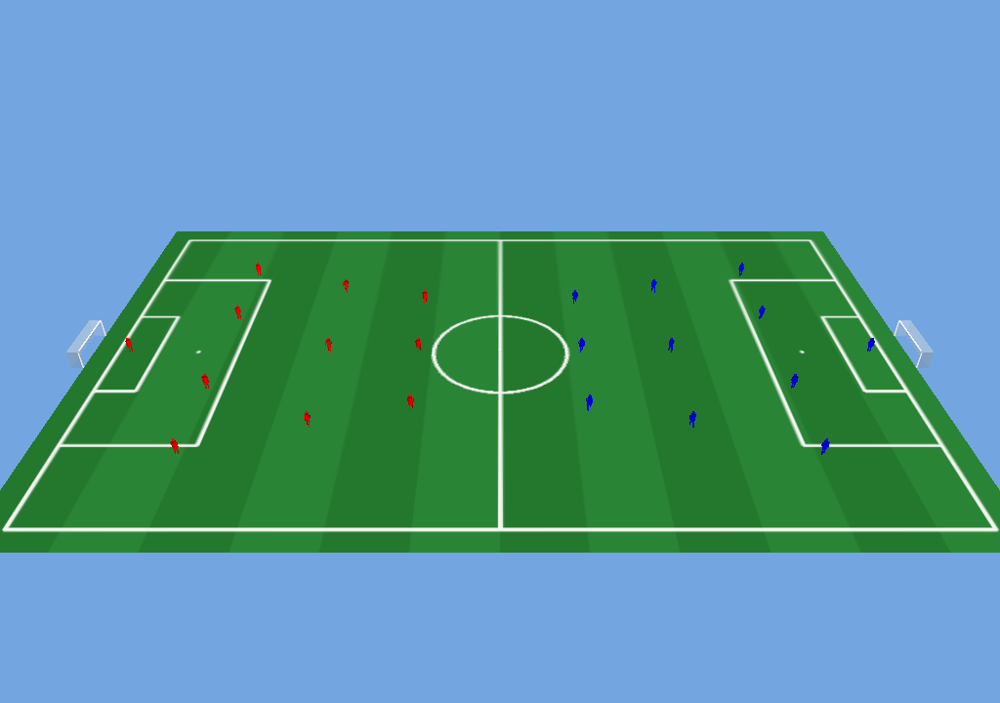
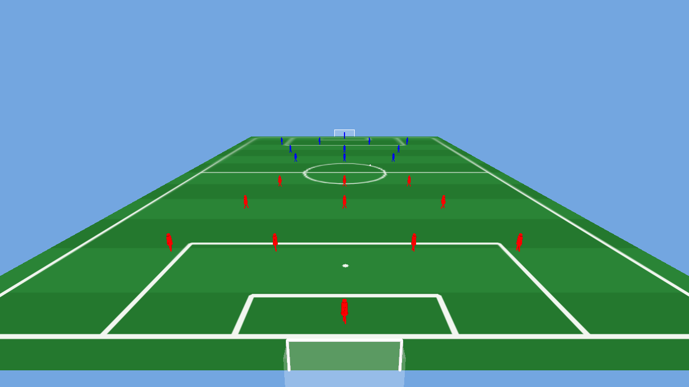
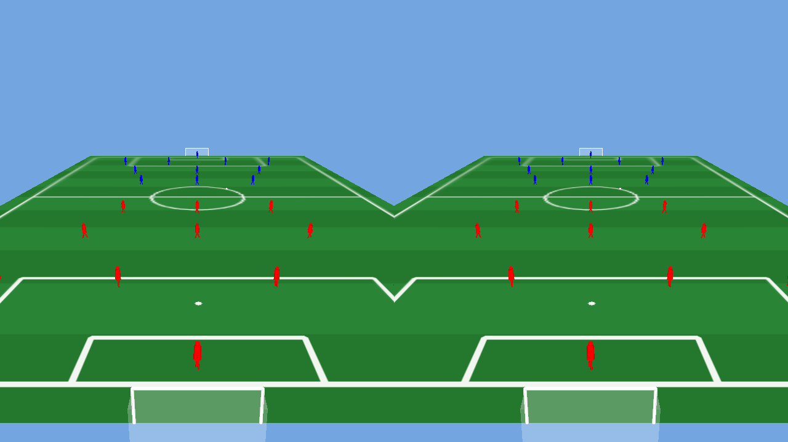
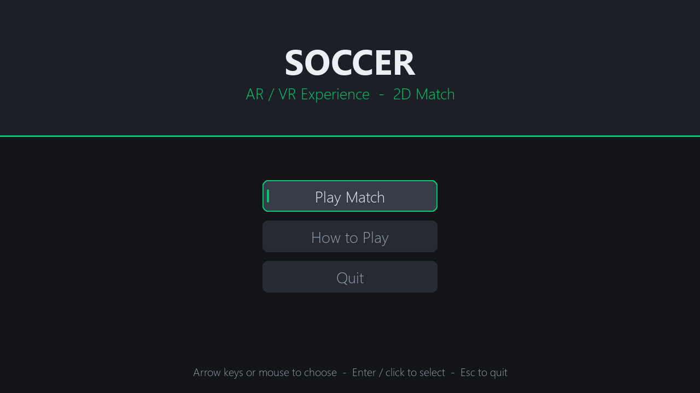
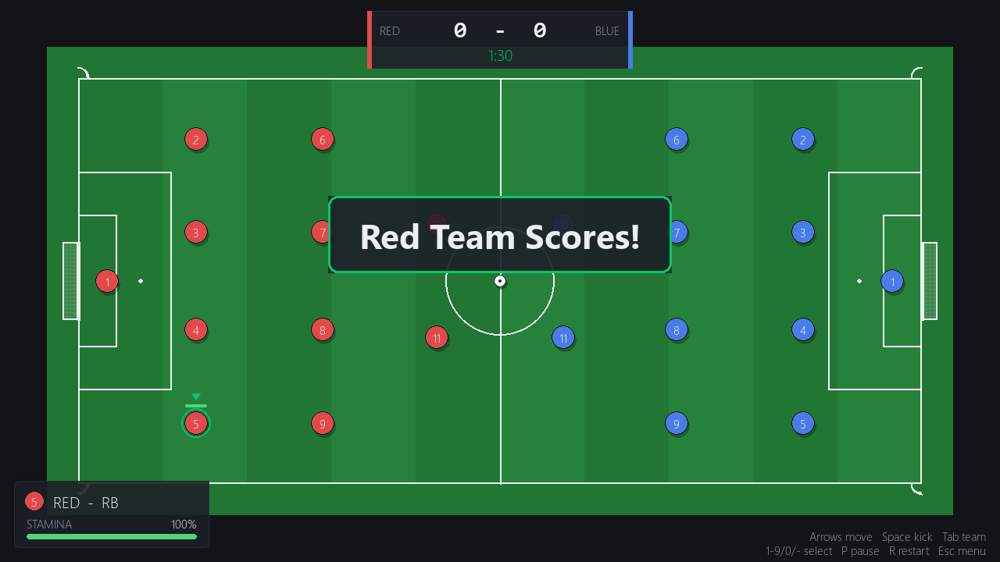

# Soccer AR/VR Experience

A desktop soccer project with four interactive modes — a playable 2D match,
an orbiting 3D pitch viewer, and experimental AR and VR prototypes — built
on top of the open-source [*Soccer on Your Tabletop*](http://grail.cs.washington.edu/projects/soccer/)
research codebase (CVPR 2018).

Developed by Tojin Varkey Simson and Jaiby Mariya Jospeh.

[](.github/workflows/ci.yml)
[](docs/VERIFICATION.md)
[](LICENSE)

---

## What this is — and isn't

| Mode | Status | What it actually is |
|---|---|---|
| **2D Soccer Game** | ✅ Stable | A real pygame match: physics, scoring, stamina, pause/restart. Verified end-to-end. |
| **3D Field Viewer** | ✅ Stable | An orbiting OpenGL view of the pitch and both teams' formations. Verified on real GPU hardware. |
| **VR Stereo Prototype** | 🧪 Experimental | A side-by-side stereo *preview* for a flat screen. **Not headset support** — no OpenXR, no head tracking, no lens distortion correction. |
| **AR Prototype** | 🧪 Experimental | Webcam + a printed ArUco marker, rendered over the live camera feed. Pose math is unit-tested and verified with a synthetic marker; **has not yet been tested with a physical printed marker in hand.** |

This project does not include multiplayer, online services, AI opponents,
or production-ready AR/VR. See [Known Limitations](#known-limitations--future-work).

For the full, line-by-line engineering history — every bug found, every
fix, and the audit that started it — see
[`SOCCER_PROJECT_AUDIT.md`](SOCCER_PROJECT_AUDIT.md) and
[`docs/VERIFICATION.md`](docs/VERIFICATION.md).

---

## Screenshots

All screenshots below are genuine captures from this repository's own code
(see [`docs/VERIFICATION.md`](docs/VERIFICATION.md) for how each was taken).

| 2D Match | 3D Field Viewer |
|---|---|
|  |  |

| VR — single view | VR — stereo (side-by-side) |
|---|---|
|  |  |

| Main Menu | Goal Celebration |
|---|---|
|  |  |

AR screenshots are not included here: the only way to demonstrate the AR
overlay is to point a webcam at something, and a real test would capture
whoever is holding the camera. `docs/VERIFICATION.md` §2 describes the AR
verification that was done (a live camera feed rendering correctly, and a
synthetic-marker pose-recovery test) without publishing that footage.

---

## Key Features

### 2D Soccer Game (stable)
- Real-time player movement with stamina-scaled speed
- All 11 players per team selectable (1–9, 0, `-`)
- Ball physics with time-based friction (frame-rate independent) and no
  spurious gravity — this is a top-down game, there is no "down"
- Goal detection that matches exactly what is drawn on screen
- Stamina that drains while running and recovers while idle
- Pause (`P`) and restart (`R`), non-blocking goal celebrations
- Scoreboard, match clock, per-player stamina indicators

### 3D Field Viewer (stable)
- Orbiting camera (arrow keys to orbit, W/S to zoom)
- Procedurally generated pitch texture (lines, penalty areas, centre circle)
  built with NumPy/OpenCV — ~400× faster than the original per-pixel loop
- Both teams in a formation derived from the pitch dimensions, not hard-coded
  positions that could drift off the pitch

### VR Stereo Prototype (experimental)
- Side-by-side stereo rendering with a correct per-eye aspect ratio
- Eye separation along the camera's own right vector, so the stereo effect
  survives turning (not just facing forward)
- WASD movement, arrow-key look, adjustable eye separation

### AR Prototype (experimental)
- Live webcam feed rendered as the 3D scene's background
- ArUco marker detection and pose estimation (OpenCV `solvePnP`), converted
  from OpenCV's to OpenGL's coordinate convention
- Projection matrix derived from the same camera intrinsics used for pose
  estimation, so the pose and the projection agree
- Graceful fallback to an orbiting desktop view when no camera or marker is
  available
- Standalone marker generator (`tools/make_markers.py`) — no extra installs
  or dataset download required just to print a marker

---

## Installation (Windows)

```powershell
git clone https://github.com/TechieTojin/-Soccer-Game.git
cd -Soccer-Game

py -3.10 -m venv .venv
.\.venv\Scripts\Activate.ps1

# Core runtime dependencies (pygame, PyOpenGL, OpenCV, NumPy, Pillow, matplotlib)
python -m pip install -r requirements.txt

# Optional: test/lint tooling
python -m pip install -r requirements-dev.txt
```

The 41 MB Barcelona sample dataset (`barcelona.zip`) is only used by the
dataset image viewer and the inherited research pipeline — none of the four
main modes need it. It is already present in this repository; extract it
with:

```powershell
Expand-Archive -Path barcelona.zip -DestinationPath barcelona
```

### Optional: research pipeline dependencies

The inherited *Soccer on Your Tabletop* pipeline (`soccer3d/`, `utils/`,
`demo/`) needs a much heavier dependency set (PyTorch, OpenMesh, …) that is
**not required** to run any of the four modes above:

```powershell
python -m pip install -r requirements-pipeline.txt
```

That pipeline additionally needs components this repository does not vendor
(Detectron/caffe2, OpenPose, compiled CUDA extensions) and has not been
verified on Windows — see `SOCCER_PROJECT_AUDIT.md` §6.

---

## Running the modes

A single launcher reaches every mode, with paths resolved from the
launcher's own location (not the current directory):

```powershell
python run_windows_version.py              # interactive menu
python run_windows_version.py --list       # list every mode and exit
python run_windows_version.py --mode 2d    # 2D match
python run_windows_version.py --mode 3d    # 3D field viewer
python run_windows_version.py --mode vr    # VR stereo preview
python run_windows_version.py --mode ar    # AR prototype
python run_windows_version.py --mode markers  # generate printable ArUco markers
```

Each mode can also be run directly:

```powershell
python soccer_game.py
python soccer3d_viewer.py
python vr_soccer_experience.py
python tools/make_markers.py --size-mm 100
python ar_soccer_experience.py --marker-mm 100 --camera 0
```

A Tkinter launcher with a live camera preview is also available:

```powershell
python modern_interface.py
```

### Controls

**2D Soccer Game**

| Key | Action |
|---|---|
| Arrow keys | Move the selected player |
| Space | Kick the ball (must be close enough) |
| Tab | Switch to the other team |
| 1–9, 0, `-` | Select player 1 through 11 |
| P | Pause / resume |
| R | Restart the match |
| Esc | Back to menu / exit |

**3D Field Viewer**

| Key | Action |
|---|---|
| Arrow keys | Orbit the camera |
| W / S | Zoom in / out |
| Esc | Quit |

**VR Stereo Prototype**

| Key | Action |
|---|---|
| WASD | Move around the pitch |
| Arrow keys | Look around |
| V | Toggle stereo / single view |
| + / - | Adjust eye separation |
| Space | Kick the ball |
| Esc | Exit |

**AR Prototype**

| Key | Action |
|---|---|
| A | Toggle AR overlay / desktop view |
| C | Cycle to the next camera |
| Arrow keys | Orbit the desktop fallback view |
| + / - | Grow / shrink the pitch on the marker |
| Space | Kick the ball |
| Esc | Exit |

---

## Technical Architecture

```
                      ┌──────────────────────────────────────────┐
  Launchers           │ run_windows_version.py   modern_interface.py │
                      └───────────┬──────────────────────┬────────┘
                                  │  (launches as a subprocess)    │
        ┌─────────────┬───────────┴───┬──────────────────┴────┐
        ▼             ▼               ▼                       ▼
   soccer_game    soccer3d_viewer  ar_soccer_experience  vr_soccer_experience
   (pygame, 2D)   (OpenGL)         (OpenGL + OpenCV ArUco) (OpenGL stereo)
        │              │               │                       │
        └──────────────┴───────┬───────┴───────────────────────┘
                                ▼
                   soccer_core/   (display-independent rules)
                   ├─ pitch.py       pitch & goal geometry (2D + 3D)
                   ├─ physics2d.py   ball physics, collisions, scoring, stamina
                   ├─ physics3d.py   ball physics for the AR/VR scenes
                   ├─ formations.py  team layouts, derived from pitch size
                   ├─ stereo.py      VR camera / eye-separation maths
                   └─ ar_pose.py     ArUco pose & projection maths
                                ▲
                                │ (shared OpenGL drawing)
                          soccer_gl.py
```

**Why `soccer_core/` exists:** every gameplay rule — where the ball bounces,
when a goal is scored, how stamina drains, how the two stereo eyes are
separated — lives in plain Python modules with no `import pygame` or
`import OpenGL`. That is what makes 113 of this project's tests runnable
without a display, a GPU, or a webcam: they call these functions directly
and check the numbers. The four front-end scripts own only input handling
and drawing, and delegate every rule to `soccer_core/`.

### Project structure

```
.
├── soccer_game.py              2D match (pygame)
├── ar_soccer_experience.py     AR prototype (OpenGL + OpenCV ArUco)
├── vr_soccer_experience.py     VR stereo prototype (OpenGL)
├── soccer3d_viewer.py          3D orbiting pitch viewer (OpenGL)
├── soccer_gl.py                Shared OpenGL drawing for AR/VR/3D
├── modern_interface.py         Tkinter launcher with camera preview
├── run_windows_version.py      Console launcher (all modes)
├── setup_ar_vr.py              Dependency / marker / launcher setup
│
├── soccer_core/                 Display-independent gameplay rules
│   ├── pitch.py, physics2d.py, physics3d.py
│   └── formations.py, stereo.py, ar_pose.py
│
├── tools/
│   └── make_markers.py          Standalone ArUco marker generator
│
├── tests/                        113 tests + a headless smoke test
├── docs/
│   ├── VERIFICATION.md           What was actually tested, and how
│   └── screenshots/               Genuine captures used in this README
│
├── requirements.txt              Runtime deps for the four modes above
├── requirements-dev.txt          pytest, ruff
├── requirements-pipeline.txt     Optional: the inherited research pipeline
│
├── soccer3d/, utils/, demo/      Inherited "Soccer on Your Tabletop" pipeline
├── barcelona.zip                 Sample dataset (used by that pipeline)
│
├── SOCCER_PROJECT_AUDIT.md       The original audit (bugs found, fixed, why)
├── THIRD_PARTY_NOTICES.md        Licence evidence for every inherited file
└── LICENSE                       BSD-2-Clause (see "License" below)
```

---

## Testing & CI

```powershell
python -m pytest -v              # 113 tests
python -m ruff check .            # lint (application code only)
python tests/smoke_2d.py --frames 600   # headless end-to-end smoke test
```

| Suite | Count | Covers |
|---|---|---|
| `tests/test_gameplay.py` | 28 | 2D match physics, goals, collisions, stamina, selection |
| `tests/test_core_physics.py` | 28 | `soccer_core` ball physics, walls, player collisions, stamina rates |
| `tests/test_stereo_and_formations.py` | 25 | VR camera maths, team formations (2D + 3D) |
| `tests/test_ar_pose.py` | 25 | ArUco pose/projection maths, including a full detection round-trip |
| `tests/test_aruco_api.py` | 7 | ArUco API compatibility, marker generator |

GitHub Actions ([`.github/workflows/ci.yml`](.github/workflows/ci.yml)) runs
all of the above on Windows and Ubuntu, Python 3.10 and 3.12, with SDL's
dummy video/audio drivers so no display or webcam is needed in CI. The
inherited research pipeline is intentionally excluded from both lint and
tests — it depends on tooling (Detectron, OpenPose, compiled CUDA
extensions) this project does not manage, and one of its vendored files
(`utils/nms/pycocotools/coco.py`) is Python 2 source that cannot even be
parsed by Python 3.

See [`docs/VERIFICATION.md`](docs/VERIFICATION.md) for exactly what was run,
on what hardware, with what result — including what was *not* verified.

---

## Engineering history

This repository went through three structured phases, starting from a
technical audit of the original project. In short:

- **Audit** ([`SOCCER_PROJECT_AUDIT.md`](SOCCER_PROJECT_AUDIT.md)) — static
  review that found the documented launcher didn't reach the 2D game, AR
  crashed on import with modern OpenCV, goal detection didn't match the
  drawn goals, gravity was wrongly applied to a top-down game, and the
  licence claim didn't match the `LICENSE` file, among other findings.
- **Phase 1 — Reliability** — fixed the dependency list, built a working
  unified launcher, fixed the ArUco API break, corrected 2D goal detection
  and physics, fixed the Tkinter crash, and added the first 31 tests.
- **Phase 2 — Polish & correctness** — rebuilt the 2D UI (menu, pause,
  non-blocking goal banner), fixed VR's stereo aspect ratio and eye
  separation, fixed inverted goalposts and player limbs, made the webcam
  frame actually render in AR, extracted `soccer_core/` so gameplay rules
  are unit-testable, and grew the suite to 113 tests.
- **Phase 3 — Verification & presentation** (this phase) — ran everything
  against real GPU and webcam hardware where possible, documented exactly
  what that showed (`docs/VERIFICATION.md`), corrected the licence/README
  mismatch, added `THIRD_PARTY_NOTICES.md`, and wrote this README.

Full details, including every audit-finding ID referenced throughout the
code's comments, are in the two documents above.

---

## Known Limitations & Future Work

- **AR is unverified with a physical printed marker.** The pose pipeline is
  unit-tested and works end-to-end with a synthetic marker image; it has
  not yet been tried with an actual printed marker in hand. Camera
  intrinsics are an assumed field of view, not a calibration.
- **VR is a flat-screen stereo preview, not headset support.** No OpenXR, no
  head tracking, no lens distortion correction.
- **Only one player per team is controllable.** The other 21 players are
  static; there is no AI opponent and this project does not add one.
- **No throw-ins, corners, or offside** in the 2D match.
- **The inherited research pipeline is unverified on Windows** and needs
  components (Detectron, OpenPose) this repository does not vendor.
- **Two components have unresolved licence provenance** — see
  `THIRD_PARTY_NOTICES.md` §5–6 (a hourglass-network file and a model
  weights file with no licence header at all).
- Tested on one GPU (Intel integrated), one webcam, one Windows build — see
  `docs/VERIFICATION.md` §6 for what that means for anyone on different
  hardware.

---

## Provenance & Acknowledgements

This project builds on **[*Soccer on Your Tabletop*](http://grail.cs.washington.edu/projects/soccer/)**
(Konstantinos Rematas, Ira Kemelmacher-Shlizerman, Brian Curless, Steve
Seitz — CVPR 2018), which supplies the `soccer3d/`, `utils/`, and `demo/`
research pipeline, the BSD-2-Clause `LICENSE` this repository is
distributed under, and the Barcelona sample dataset. The 2D game, the 3D
viewer, the AR/VR prototypes, every launcher, and the `soccer_core` /
`soccer_gl` modules are original work built alongside that codebase, not
part of it.

Also vendored, each under its own licence (full details in
[`THIRD_PARTY_NOTICES.md`](THIRD_PARTY_NOTICES.md)):

- **Fast/Faster R-CNN** NMS code (Ross Girshick, Sergey Karayev — Microsoft,
  2015) — MIT
- **pycocotools** (Piotr Dollar, Tsung-Yi Lin — 2015) — Simplified BSD
- **Detectron inference script** (Facebook, 2017) — Apache-2.0

Thanks also to the Pygame, PyOpenGL, and OpenCV communities whose tools this
project is built on.

## License

This repository is distributed under the **BSD 2-Clause License** — see
[`LICENSE`](LICENSE). That file's copyright notice names the original
*Soccer on Your Tabletop* authors; the licence covers the repository as a
whole, including the original contributions listed above. It is **not**
MIT-licensed, correcting an earlier version of this README.

Several vendored components carry their own licences (MIT, Apache-2.0, and
one "Simplified BSD" component) — see
[`THIRD_PARTY_NOTICES.md`](THIRD_PARTY_NOTICES.md) for exactly which files
and what evidence backs each claim, including two components whose licence
could not be determined from the files alone.

## Contact

- Tojin Varkey Simson
- Jaiby Mariya Jospeh
